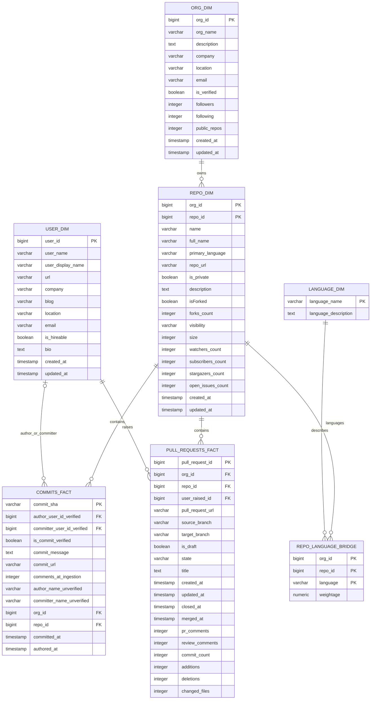

# GitHub extraction datasets ERD

View of the seven extracted datasets. Fact tables are listed first;
the remaining tables provide organization, repository, user, and language
details.

Repository tables use the composite key `(org_id, repo_id)`. Commit author and
committer IDs can be null when GitHub does not provide a verified account.
